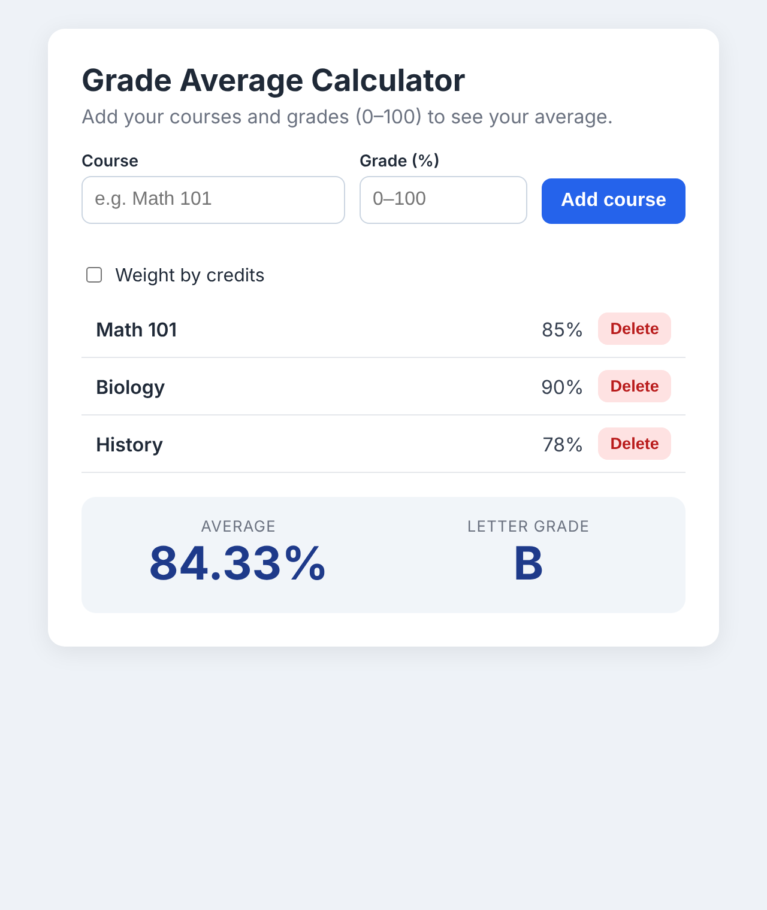

# Grade Average Calculator

CMPS 510 final project (Project 8), individual work.

A small web app that calculates the average of your course grades and shows the letter grade.

**Live app:** https://dharuvi.github.io/Grade-Average-Calculator/ 

## Features
- Add a course with a name and a grade (0–100). Invalid input shows a message.
- Shows the average and the letter grade (A 90+, B 80+, C 70+, D 60+, F below 60).
- Delete a course; the average updates immediately.
- Courses are saved in the browser's `localStorage`, so they stay after a refresh.
- Optional extra: "Weight by credits" switch for a credit-weighted average.

## Run it
Open `index.html` in a browser. No build step, server or sign-in needed.

## Tests
`node test.js` checks the calculation logic (two examples from the report, the weighted average and grade boundaries).

## Files
| File | Purpose |
|---|---|
| `index.html` | Page structure |
| `style.css` | Styling (works on phones) |
| `grades.js` | Average and letter-grade logic (no DOM, testable) |
| `app.js` | Page behaviour: add, delete, save, render |
| `test.js` | Logic tests |

## Tools and AI used
Plain HTML, CSS and JavaScript, no libraries. Built with help from Claude (Anthropic's AI assistant) for code and the report; Playwright was used to check the page in a browser.

